# Joly World

A colourful low-poly side-view platformer built with Unity: a child walks, jumps, sprints and
dashes through four little lands, from a sunny meadow by the river to the snowy peaks behind it,
collecting coins and hidden gems, drinking potions from a 7-slot hotbar and popping spiky
critters with a magic spark. It plays with a keyboard, a gamepad or the mouse in the menus.

It is a rebuild of a prototype I made in 2021 whose project files were lost (see
[Where it came from](#where-it-came-from)).

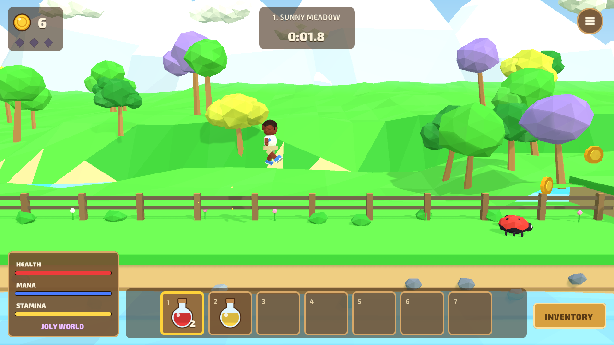

| | |
|---|---|
| 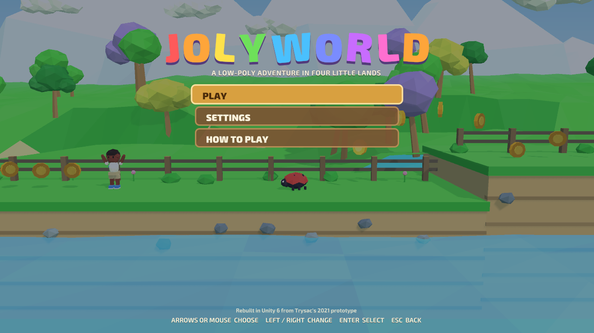 | 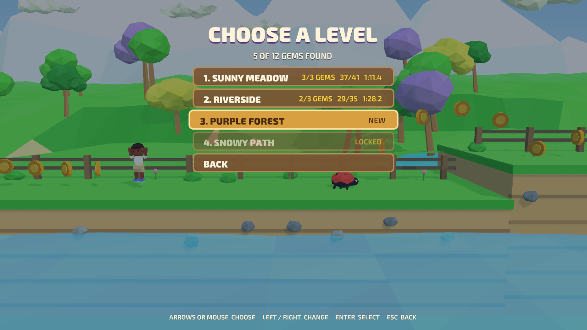 |
| 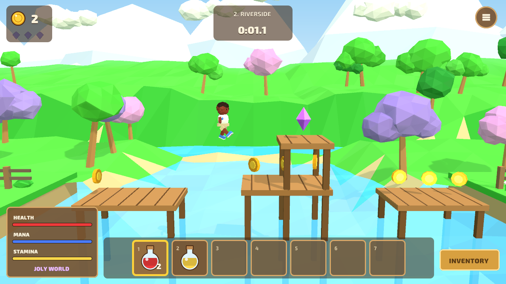 | 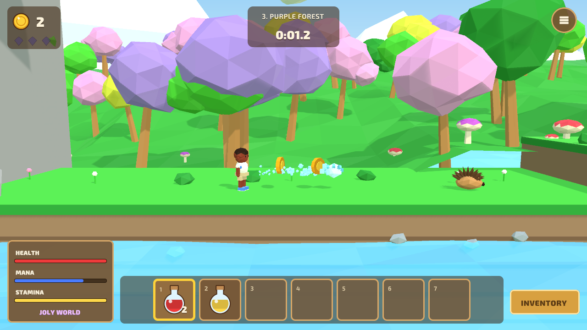 |
| 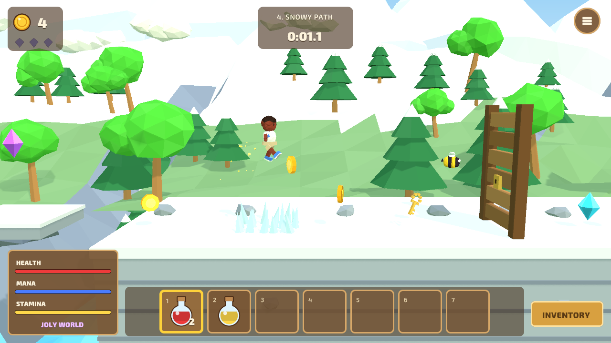 | 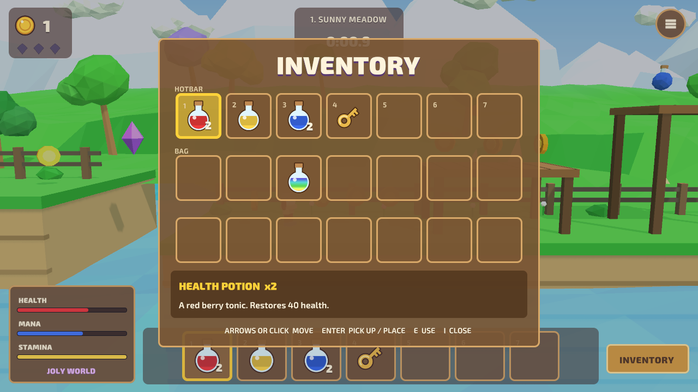 |
| 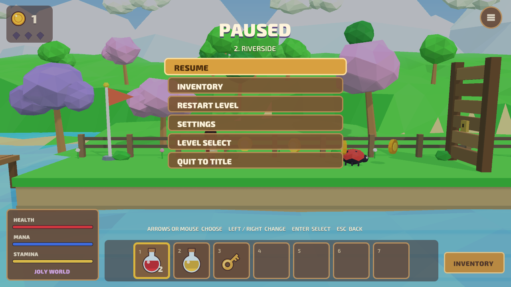 | 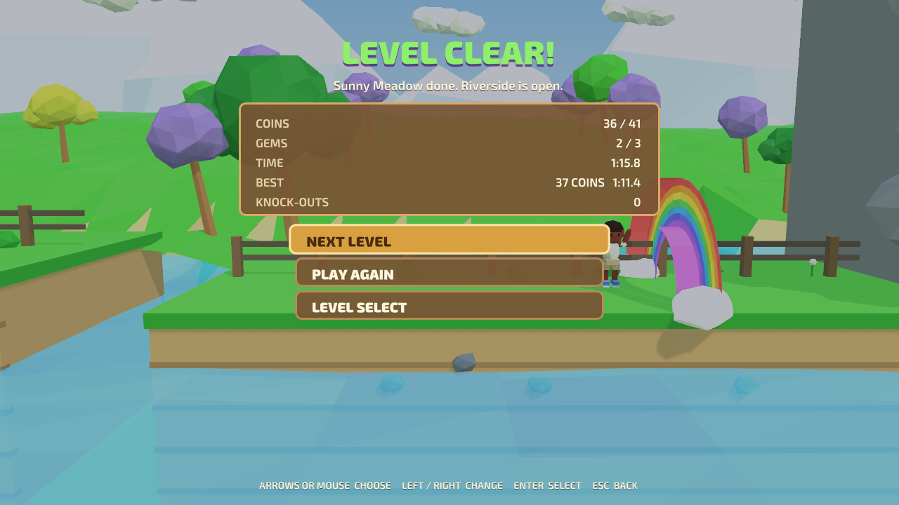 |
| 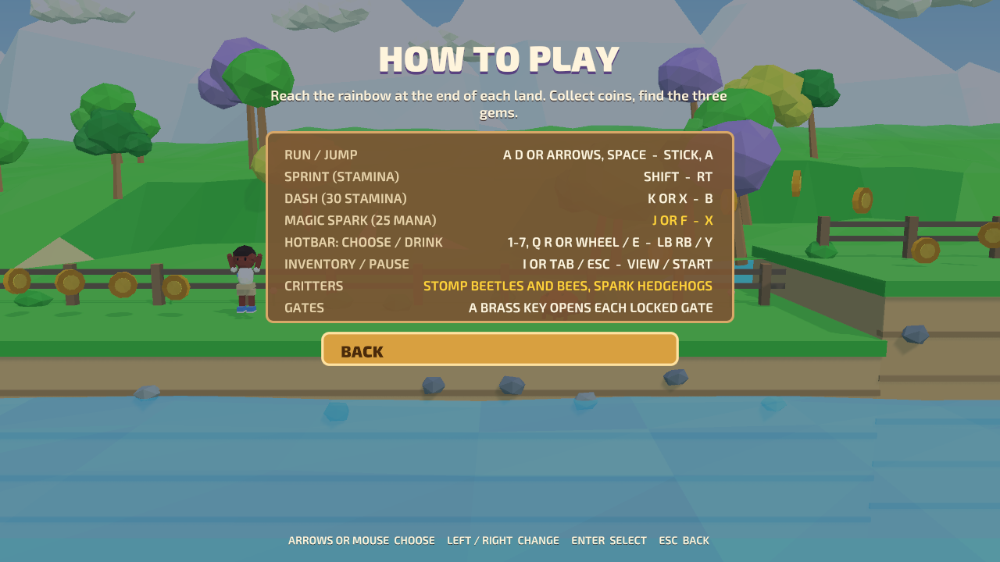 | |

## Play it

- **In your browser:** [trysac.github.io/Joly-World](https://trysac.github.io/Joly-World/)
- **On itch.io:** [trysac.itch.io/joly-world](https://trysac.itch.io/joly-world)
- **Get the code:** fork this repository, or clone it:

  ```bash
  git clone https://github.com/Trysac/Joly-World.git
  ```

## Run it

1. Install **Unity 6000.3.27f1 (Unity 6 LTS)** with Unity Hub (add the Windows or Web build
   support module if you want to build players).
2. In Unity Hub choose **Add → Add project from disk** and select the repository folder.
3. Open `Assets/Scenes/Main.unity` and press **Play**.

To build a player use **File → Build Profiles** (Windows or Web), or build from a terminal into
a folder outside the repository:

```bash
Unity -batchmode -quit -projectPath . -executeMethod JolyWorld.EditorTools.ProjectBuilder.BuildWebGL -buildOutput ../build/web
```

(`BuildWindows` works the same way.) The WebGL build is uncompressed with a 1280x720 canvas, so
it runs from any static host such as GitHub Pages or itch.io.

The tests run from **Window → General → Test Runner** (EditMode and PlayMode), or from a terminal:

```bash
Unity -batchmode -projectPath . -runTests -testPlatform EditMode -testResults results.xml
Unity -batchmode -projectPath . -runTests -testPlatform PlayMode -testResults playmode.xml
```

The scene, materials, sky, interface icons, font atlases, app icon and player settings are
generated by **Joly World → Regenerate Art, Scene and Player Settings**
(`ProjectBuilder.SetUpProject`), and the sounds and music by `python tools/audio/build.py`
(needs ffmpeg). The README screenshots come from an opt-in hook: run a built player with
`-screenshot <folder>` (optionally `-scenario title,meadow,forest,...`), or, without a player,
`Unity -batchmode -projectPath . -executeMethod JolyWorld.EditorTools.ProjectBuilder.CaptureScreenshots -screenshot <folder>`.

## Controls

| Action | Keyboard and mouse | Gamepad |
|---|---|---|
| Run | A / D or ← / → | Left stick or D-pad |
| Jump (hold for a higher jump) | Space, W or ↑ | A |
| Sprint (uses stamina) | Shift (held) | RT or LT (held) |
| Dash (30 stamina) | K or X | B |
| Magic spark (25 mana) | J or F | X |
| Choose a hotbar slot | 1-7, Q / R or the mouse wheel, or click a slot (clicking also drinks) | LB / RB |
| Drink the chosen potion | E | Y |
| Inventory | I, Tab or the **Inventory** button | View |
| Pause | Esc, P or the round menu button | Start |
| Menus | ↑ / ↓ or the mouse to choose, ← / → to change a value, Enter to select, Esc to go back | D-pad or stick, A to select, B to go back |
| Inventory screen | Arrows or click to move, Enter or click to pick up and put down (swap), E to drink, I to close | D-pad, A, X to drink, B to close |

## How it plays

- **Four lands.** Sunny Meadow (run, jump, beetles, thorns), Riverside (plank bridges over the
  river, bees, the first locked gate), Purple Forest (giant mushrooms, spiky hedgehogs) and
  Snowy Path (a climb over rocks and ice with every critter). Each ends at a rainbow. Clearing a
  land opens the next one.
- **Health, mana and stamina**, the three bars of the 2021 HUD, each with a use. Health drops
  when a critter or thorns hit you (with a moment of safety after each hit) and when you fall in
  the river; at zero you are back at the last flag with full bars. Mana (it slowly refills)
  pays for the magic spark, the only safe way past a hedgehog. Stamina (it refills quickly)
  pays for sprinting and dashing.
- **The jump** has coyote time, a jump buffer and a shorter hop when you let go early. Beetles
  and bees can be stomped; hedgehogs cannot.
- **Hotbar and inventory.** Seven hotbar slots and a 14-slot bag. Health, mana and stamina
  potions, a rare rainbow elixir that refills everything, and brass keys that open the locked
  gates. A potion that would do nothing (its bar is full) is kept for later.
- **Collect** the coins and the three gems hidden in each land, some up on ledges, some over
  the river and one behind each gate.
- **Records** on the device (PlayerPrefs): which lands are cleared, the most coins and the best
  time in each, and every gem ever found. The volume settings are saved too.

## What I learned / technically interesting

- **The rules without the engine.** The platformer motor (acceleration, gravity, variable jump
  height, coyote time, jump buffer, sprint, dash, solid boxes and one-way platforms), the bars,
  the inventory and hotbar, critters, the spark, pickups, gates, checkpoints, the river, the
  levels and the saved progress live in `Assets/Scripts/Core`, a plain C# assembly with no Unity
  references, covered by 119 EditMode tests. 14 PlayMode tests drive the real scene: the title,
  the level select, coins, potions, the river, pause, restart, the inventory screen, the
  settings, the spark and the results saving the records.
- **Levels checked against the jump.** `Motor.JumpReach(rise)` works out how far a running
  jump carries the hero for a given rise; a test proves it against the simulated motor (a gap a
  little shorter is cleared, a longer one is not). The level design tests then use it, with a
  safety margin, to check that every land can be finished with plain jumps, that every coin,
  gem and potion can be reached, that each gate has its key before it and is too tall to jump,
  and that critters patrol on solid ground.
- **Everything is generated.** The world is built in code from the level data as flat-shaded
  low-poly meshes coloured per vertex (one material, a few merged meshes per level), with two
  small surface shaders for the soft lighting and the rippling river. Textures, icons, the
  scene, the font atlases and the player settings come from an editor script
  (`ProjectBuilder.cs`); the sounds and the three tunes come from a small Python synthesizer
  (`tools/audio`). The HUD and menus are UI Toolkit, built in code (`Hud.cs`) and styled with
  USS to match the 2021 layout.

## Where it came from

Joly World started in March 2021 as a Unity prototype I uploaded as a draft to itch.io ("Just
the Prototipe": tags 3d, adventure, colorful, low-poly). Its project was never pushed and is
lost, so in 2026 the game was rebuilt from scratch in Unity 6 from what the two surviving
captures show: the bright meadow by the river, round green, yellow and purple trees, fences and
snowy mountains, a child hero, the coin counter, the Health / Mana / Stamina board, the 7-slot
hotbar with an Inventory button and the round menu button.

| | |
|---|---|
| 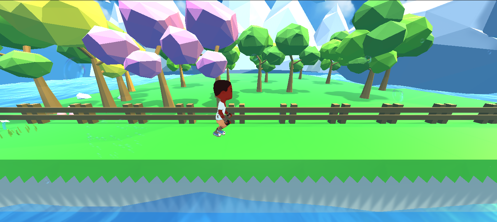 | 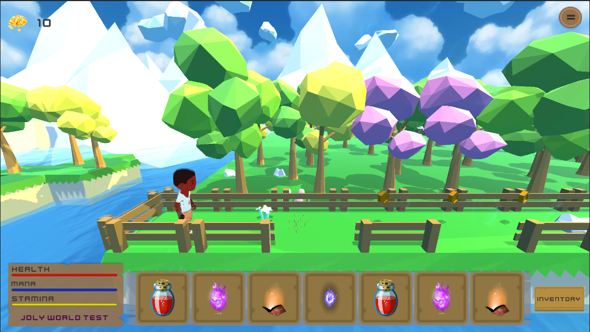 |

These two captures of the 2021 build may show third-party art the prototype used, so they are
kept only as a record of that version and are not covered by this repository's MIT licence.

## Credits

- **Fonts:** Exo 2 Black and Exo 2 SemiBold by Natanael Gama, licensed under the
  [SIL Open Font License 1.1](Assets/Fonts/OFL.txt); they ship unmodified in `Assets/Fonts`.
- Everything else (code, meshes, shaders, textures, icons, sounds, music) was made for this
  project. See [CREDITS.md](CREDITS.md).

## License

The code and the generated assets are under the [MIT License](LICENSE). The Exo 2 fonts keep
their own SIL Open Font License (`Assets/Fonts/OFL.txt`); the 2021 captures in `docs/original`
are excluded.
